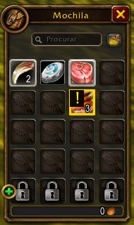
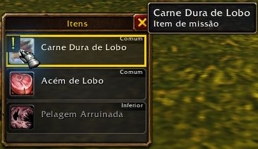
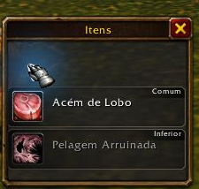
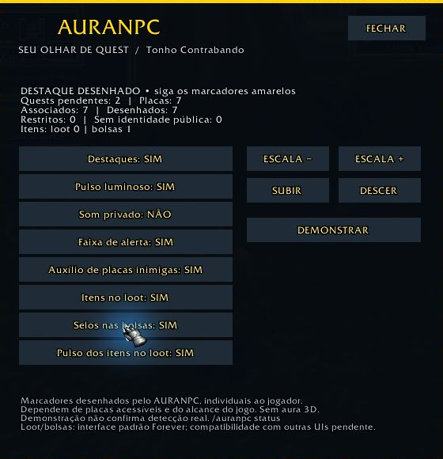

# AURANPC 2.1.1 — sessão real de 18/11/2026

Status: **PARTIAL_CLIENT_TESTED**. Cliente confirmado por GetBuildInfo: **1.60.1, build70959, interface16001**, ptBR. Alliance, guerreiro nível1, Vale de Vila Norte, mundo aberto, apenas AURANPC instalado. Não certifica Horde, dungeons, todas as quests ou outras interfaces.

## Reprodução e causa

A instalação2.1.0 correspondia ao Items.lua entregue (SHA256 7b9db18deb0b1025485aa21b2470f3219e88cf241865012e26608b1b0143b2e8). Carne Dura de Lobo estava na mochila e o diário mostrava a quest33, Só louco não come lobo, com objetivo público `1/8 Carne Dura de Lobo`. O selo não aparecia.

C_Container.GetContainerItemQuestInfo retornou isQuestItem=true, questID=nil, isActive=false. O tooltip tinha ItemName(type22) e Item de missão(type20), sem QuestTitle. Portanto, exigir questID/QuestTitle/isActive excluía um item real necessário. A correção indexa nomes exatos de objetivos públicos de tipo item no diário atual e compara ao nome público do item; classificação genérica isolada continua insuficiente. Retira só contagens de progresso dos formatos explícitos, sem substring aproximada, coordenadas ou catálogo inventado.

## Resultados observados

- PASS: selo próprio ! e borda amarela na Carne Dura de Lobo da mochila; itens comuns vizinhos sem selo.
- PASS: arrastar para outro slot acompanha o item e limpa o slot antigo.
- PASS: dois lobos mortos manualmente para teste; primeiro saque automático avançou1/8→2/8. Com auto-loot temporariamente desligado, o segundo mostrou Carne Dura de Lobo destacada na janela real de loot; Acém de Lobo e Pelagem Arruinada sem selo.
- PASS: clique no ícone da carne coletou normalmente, removeu o overlay da linha e avançou2/8→3/8. Clique no texto da linha não coletou; não foi tratado como falha do overlay sem evidência.
- PASS: mochila mostrou a pilha3 com exclamação após a coleta.
- PASS: reload reconstruiu o selo; abrir e fechar painel, splash/créditos, desligar e religar Selos nas bolsas funcionaram; NPCs continuaram destacados.
- Descarte CANCELADO: a confirmação informou que destruir a carne também abandonaria a missão. A missão e as três carnes foram preservadas; não se declara ciclo de destruição/reaceite testado.

## Correção operacional durante a sessão

A primeira instalação de teste copiou por engano o TOC do código-fonte, anterior à injeção do empacotador. Isso omitiu TonhoBranding.lua e gerou erro no painel (Visuals.lua48, depois Core.lua75). Foi instalado o TOC de addons/AURANPC gerado pelo circuito, que carrega o branding primeiro. Após reload, painel/créditos e controles foram observados funcionando. Não era a causa original do selo ausente em2.1.0. Próximas instalações devem usar exclusivamente o pacote gerado, nunca misturar arquivos de origem com o TOC final.

## Estado final e limites

Personagem vivo, fora de combate, vida cheia, sem autorun, missão33 em3/8. Selo reativado; painel e mochila fechados. autoInteract restaurado0, autoLootDefault restaurado1, conferidos por consulta. scriptErrors foi ligado para diagnóstico e mantido ligado. Sem confirmação automatizada de avisos de scripts.

Não executados: Horde real, dungeon, bolsas combinadas, rolagem longa, outras UIs, entrega/abandono/conclusão da quest, outros idiomas, longa duração/performance e auditoria completa de taint. Mock não substitui esses testes. Metadados globais clientVerified:false permanecem.

Capturas abaixo são recortes reais sem chat ou nomes de jogadores; arquivos completos ficam privados em .data. As imagens UI-* anteriores continuam sendo mocks.

